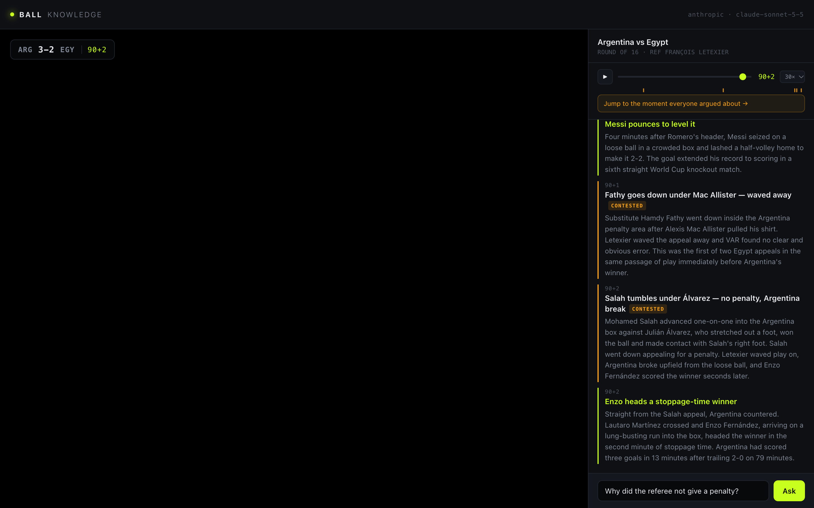
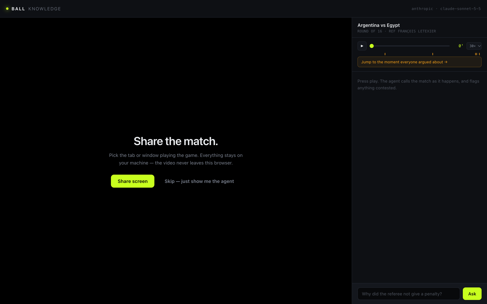

# Ball Knowledge

**A football match companion that turns "this is rigged" into "ah, that's the rule."**



## What it does

- **Calls the match as it happens.** Press play and a verified event timeline feeds goals, cards and VAR checks into a live commentary rail, with every arguable decision flagged `CONTESTED`.
- **Answers "why?" against the real rulebook.** Ask anything ("why wasn't that a penalty?") and it explains the decision citing the actual IFAB Laws of the Game by number, quoting the phrase that decides it.
- **Stays honest on the close ones.** When a call was genuinely disputed it gives the strongest version of both sides instead of defending the referee by reflex. It never claims a match was fixed.
- **Watches with you, privately.** Share the tab playing the match and it sits next to it. The video never leaves your browser.
- **Works with Claude or OpenAI.** Whichever API key is in `.env` wins. Swapping providers touches one file.

## How it works

Three separate parts, on purpose:

| Part | Job |
|---|---|
| **Event feed** | What happened and when. Ground truth. |
| **Laws of the Game** | What the rule says. Verbatim IFAB text in `engine/rules/`. |
| **The model** | Explains one in terms of the other. |

No football API answers "why wasn't that a penalty." Feeds like API-Football, Sportradar and Opta give you goals, cards and subs, sometimes a VAR flag, but never the referee's reasoning. The reasoning lives in the gap between the event feed and the rulebook, and that gap is the product.

**The screen share is not the event source.** A vision model watching a compressed broadcast cannot reliably call offside, contact or handball, and it will be confident and wrong. So the shared screen is only what you watch: `getDisplayMedia` gives the page a `MediaStream` that never touches the server. The model gets the event feed and your question, not a single pixel.

**The whole rulebook goes into every prompt.** Not retrieval. A static corpus is a stable prompt prefix, so it caches at about 0.1x the price after the first call (with a 1 hour TTL, because people ask every few minutes, not every few seconds). Retrieving two or three laws would produce a different prefix every time, never cache, and add a way to miss the law you needed.

**Reasoning is streamed, not hidden.** The model's summarized thinking renders as a dim line above each answer, so the wait shows something worth reading instead of a spinner.



## Run it

Needs Node 20.6 or newer and one API key (Anthropic or OpenAI).

```bash
cp .env.example .env     # add ONE api key
npm install
npm start                # http://localhost:4200
```

Pick a different port with `PORT=4300 npm start`. Override the model with `ANTHROPIC_MODEL` or `OPENAI_MODEL` (defaults: `claude-sonnet-5-5`, `gpt-4o`). `EFFORT=low|medium|high` trades speed for depth.

Click **Share screen** (or **Skip**), press play, then hit **Jump to the moment everyone argued about** and ask your question.

## Layout

```
server.js              plain node:http server, SSE streaming
adapters/llm.js        Anthropic | OpenAI, auto-detected from env, one file to swap
engine/context.js      the persona (stable, cached) + per-request match context
engine/rules.js        loads the Laws corpus
engine/rules/*.md      IFAB text: Laws 11, 12, 14 + the VAR protocol
engine/fixtures/*.json verified event timelines
public/                the app, vanilla JS, no build step
```

## Adding a match

Drop a JSON file in `engine/fixtures/` shaped like the existing one. Events need `minute`, `type`, `headline` and `detail`. Set `contested: true` and fill the `controversy` block on the arguable ones. That block is what makes an answer specific instead of generic.

## Rulebook notes (if you ever re-scrape it)

`engine/rules/` is verbatim IFAB text, checked line by line against the official PDF. Things that bit during the build:

- `theifab.com/laws/latest/` carries inline `<deleted>`/`<added>` change markup. Strip the tags naively and you get clauses that say the opposite of the law.
- Law 14 section 14.3 is an image on the web page. It has to come from the PDF, in layout mode.
- There are five reviewable VAR categories in the current protocol, not the four quoted all over the internet.
- "Attacking Possession Phase" (APP) is not IFAB language. It is fenced behind the only `UNVERIFIED` marker in the corpus.
- The Laws contain no 10-second rule and no distance limit on how far a VAR review reaches back. Many "that was 100 yards away!" complaints are about a rule that does not exist.

## Known gaps

- **Replay only.** The live feed adapter is a stub. Live polling a full match is about 240 calls, beyond most free tiers.
- **No clock OCR.** The transport bar syncs the clock to your footage by hand.
- **`OPENAI_MODEL` defaults to `gpt-4o`.** Check it against OpenAI's current list.
- **Keep the corpus cached.** With caching a question costs well under a cent. Turning it into a retrieval step would cost more and miss laws.

## Tech stack

Node.js (no framework), vanilla JS + CSS, Server-Sent Events, Anthropic SDK (Claude with prompt caching and adaptive thinking), OpenAI SDK, IFAB Laws of the Game 2026/27.
